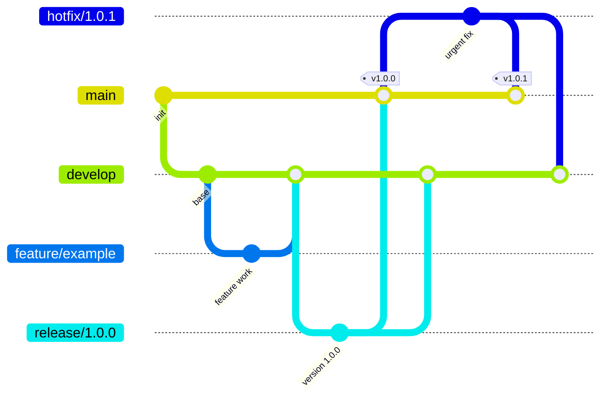

# 🌿 GitFlow con GitHub: práctica guiada con Spring Boot

Guía de consulta para aprender y recordar **GitFlow** trabajando como en un equipo: dos developers, ramas protegidas,
Pull Requests, revisiones, conflictos, releases y hotfixes.

**Fuentes de referencia:**

- [A successful Git branching model, de Vincent Driessen](https://nvie.com/posts/a-successful-git-branching-model/)
  (autor del modelo)
- [GitFlow en GitHub, de G. Mizael Mtz Hdzn (YouTube)](https://www.youtube.com/watch?v=LkYWop93S70&t=2176s)
- [GitHub Docs: reglas disponibles en los rulesets](https://docs.github.com/en/enterprise-cloud@latest/repositories/configuring-branches-and-merges-in-your-repository/managing-rulesets/available-rules-for-rulesets)
- [GitHub Docs: aprobación de Pull Requests](https://docs.github.com/en/pull-requests/how-tos/review-pull-requests/approving-a-pull-request-with-required-reviews)
- [Git Credential Manager: varios usuarios](https://github.com/git-ecosystem/git-credential-manager/blob/release/docs/multiple-users.md)

---

## 🧭 Índice

**Teoría**

1. [¿Qué es GitFlow?](#que-es)
2. [Ramas, origen y destino](#ramas)
3. [Convenciones del equipo](#convenciones)
4. [Versionado y tags](#versionado)

**Práctica**

5. [Equipo, reglas y recorrido](#equipo)
6. [Preparación del entorno](#preparacion)
7. [Escenario 1: primera feature](#e1)
8. [Escenario 2: Pull Request rechazado](#e2)
9. [Escenario 3: conflicto entre dos features](#e3)
10. [Escenario 4: release 1.0.0 con un bugfix](#e4)
11. [Escenario 5: hotfix 1.0.1](#e5)
12. [Escenario 6: hotfix 1.0.2 con una release abierta](#e6)
13. [Escenario 7: publicación de la release 1.1.0](#e7)

**Consulta**

14. [Recetas rápidas](#recetas)
15. [Índice de comandos](#comandos)
16. [Errores comunes y buenas prácticas](#buenas-practicas)

### ⚡ Necesito...

| Necesito...                             | Receta                          | Ejemplo completo               |
|-----------------------------------------|---------------------------------|--------------------------------|
| Crear una funcionalidad                 | [Feature](#receta-feature)      | [Escenario 1](#e1)             |
| Corregir un PR rechazado                | [PR rechazado](#receta-rechazo) | [Escenario 2](#e2)             |
| Resolver un conflicto                   | [Conflicto](#receta-conflicto)  | [Escenario 3](#e3)             |
| Publicar una versión                    | [Release](#receta-release)      | [Escenarios 4](#e4) y [7](#e7) |
| Corregir un error de producción         | [Hotfix](#receta-hotfix)        | [Escenario 5](#e5)             |
| Hacer un hotfix con una release abierta | [Hotfix](#receta-hotfix)        | [Escenario 6](#e6)             |

---

## 📚 ¿Qué es GitFlow?

**GitFlow** es un modelo de ramificación: un conjunto de reglas que define **qué ramas existen, de dónde nace cada una,
dónde se integra y cuándo se elimina**. No es un comando ni una función de Git. Técnicamente, todas son ramas normales;
lo que cambia es cómo las usa el equipo.

Usa dos **ramas principales** (permanentes) y varias **ramas de soporte** (temporales).

### 🧠 ¿Cuándo conviene usarlo?

El propio autor agregó en 2020
una [nota de reflexión](https://nvie.com/posts/a-successful-git-branching-model/#note-of-reflection-march-5-2020):

- ✅ GitFlow puede encajar bien si el software tiene **versiones explícitas** o si hay que **dar soporte a varias
  versiones** en uso.
- ⚠️ Si el equipo hace **entrega continua** (habitual en aplicaciones web), recomienda un flujo más simple, como
  **GitHub Flow**.

No es una receta universal: cada equipo elige según su contexto.

> ℹ️ El modelo básico mantiene una sola línea en producción. Dar soporte simultáneo a varias versiones (por ejemplo,
> `1.x` y `2.x`) requiere ramas de mantenimiento adicionales, que esta práctica no cubre.

### 🗺️ El gráfico del autor

*Gráfico de [Vincent Driessen](https://nvie.com/about/),
tomado de [su artículo](https://nvie.com/posts/a-successful-git-branching-model/).
Licencia [CC BY-SA](https://creativecommons.org/licenses/by-sa/4.0/).*

El tiempo avanza de **arriba hacia abajo**. El gráfico es de 2010, así que usa otros nombres:

| En el gráfico                    | En esta guía            |
|----------------------------------|-------------------------|
| `master`                         | `main`                  |
| `release-*`                      | `release/<version>`     |
| `hotfix-*`                       | `hotfix/<version>`      |
| Nombres libres para las features | `feature/<descripcion>` |
| Tags como `1.0`                  | `v1.0.0`                |

### 🔭 El flujo resumido

> ℹ️ Los gráficos usan **Mermaid**. GitHub los dibuja automáticamente. Si tu editor muestra solo el código, necesitas
> un visor o extensión con soporte para Mermaid. Los gráficos están **simplificados**: no dibujan las ramas auxiliares
> usadas para resolver conflictos.

---

## 🌳 Ramas, origen y destino

### 🏛️ Ramas principales

Tienen vida indefinida. **Nunca se eliminan** y en esta práctica **nadie hace push directo** a ellas después de la
preparación inicial.

- **`main`**: refleja lo que está **en producción o listo para producción**. Cada integración a `main` representa una
  versión nueva y recibe un tag.
- **`develop`**: es la rama de integración. Contiene los últimos cambios terminados para la **próxima versión**.

### 🧩 Ramas de soporte

Tienen vida limitada y se eliminan al cumplir su propósito.

- **`feature/*`**: desarrolla una funcionalidad.
- **`release/*`**: prepara una versión. Se prueba y solo admite correcciones y ajustes de la versión. **No entran
  funcionalidades nuevas.**
- **`hotfix/*`**: corrige un error urgente de producción. Como nace de `main`, no arrastra los cambios de `develop` que
  aún no se han publicado.

### 🔀 Tabla de origen y destino

| Rama                               | Sale de               | Se integra a             | ¿Se elimina?         |
|------------------------------------|-----------------------|--------------------------|----------------------|
| `main`                             | — (rama inicial)      | —                        | No                   |
| `develop`                          | `main` (una sola vez) | —                        | No                   |
| `feature/*`                        | `develop`             | `develop`                | Sí                   |
| `release/*`                        | `develop`             | `main` **y** `develop`   | Sí, después de ambas |
| `hotfix/*`                         | `main`                | `main` **y** `develop`   | Sí, después de ambas |
| `hotfix/*` con una release abierta | `main`                | `main` **y** `release/*` | Sí, después de ambas |

> 📌 `develop` **no se integra directamente a `main`**. Sus cambios llegan mediante una `release/*`.

> 📌 Una **release abierta** es una rama `release/*` ya creada que todavía no ha terminado (por ejemplo, aún está
> siendo probada). Si en ese momento se necesita un hotfix, este se integra en `main` y en la **release abierta**. La
> corrección llega a `develop` cuando la release se integra en `develop`. Si `develop` la necesita antes, el hotfix
> también se integra directamente en `develop`.

Para entender mejor el caso de un `hotfix/*` **con una release abierta**, veamos el siguiente ejemplo:

1. En producción (`main`) está la versión `1.0.1`.
2. Creas `release/1.1.0` desde `develop` y empiezan las pruebas. **La release está abierta.**
3. Mientras pruebas la release, aparece un error urgente en producción.
4. Creas `hotfix/1.0.2` desde `main` y corriges el error.
5. El hotfix se integra en:
    - `main`, para corregir producción (y se crea el tag `v1.0.2`).
    - `release/1.1.0`, para que la próxima versión también tenga la corrección.
6. Cuando `release/1.1.0` supera las pruebas, se integra en `main` y en `develop`. Así, la corrección del hotfix llega
   también a `develop`.

Si no integras el hotfix en la **release abierta**, esta no tendrá la corrección: probarías la `1.1.0` sin el arreglo y
la corrección no llegaría a `develop` a través de la release.

**¿Y si `develop` necesita la corrección antes?**

Por ejemplo, un developer está trabajando en una feature y ese error no le permite avanzar. En ese caso, no espera a que
termine la release: el hotfix se integra en `main`, en la `release` abierta y además en `develop`. La rama del hotfix se
elimina después de completar esas integraciones.

### 🛠️ Ramas adicionales (convenciones de equipo)

No son tipos del modelo original, pero ayudan cuando todo entra mediante **Pull Requests:**

| Rama       | Sale de     | Se integra a         | Para qué                                                        |
|------------|-------------|----------------------|-----------------------------------------------------------------|
| `bugfix/*` | `release/*` | La misma `release/*` | Error encontrado al probar la release                           |
| `bugfix/*` | `develop`   | `develop`            | Error aún no publicado, fuera de una release                    |
| `chore/*`  | `develop`   | `develop`            | Cambiar la versión o resolver conflictos al traer otros cambios |
| `chore/*`  | `release/*` | La misma `release/*` | Resolver conflictos al llevar un hotfix a la release            |

> ℹ️ El [artículo original de Vincent Driessen](https://nvie.com/posts/a-successful-git-branching-model/), autor de
> GitFlow, permite corregir errores **directamente** en la `release/*`. Aquí usamos `bugfix/*` para que cada corrección
> pase por un Pull Request y tenga su revisión.

> ℹ️ Una rama `chore/*` es temporal y sirve para tareas de apoyo, no para crear funcionalidades ni corregir errores.
> Por ejemplo, para llevar `release/1.0.0` a `develop` cuando hay conflictos: se crea la `chore/*` desde `develop`, se
> hace merge de `release/1.0.0` dentro de ella, se resuelven los conflictos y se abre un PR hacia `develop`. Se elimina
> después de integrarse.
>
> En general, `chore` se usa para tareas de mantenimiento. En esta guía nos limitamos a esos dos usos para que sea fácil
> de seguir.

---

## 📏 Convenciones del equipo

### 🏷️ Nombres de ramas

En inglés, en minúsculas y con guiones.

| Tipo          | Formato                       | Ejemplo                               |
|---------------|-------------------------------|---------------------------------------|
| Feature       | `feature/<descripcion>`       | `feature/create-product`              |
| Release       | `release/<MAJOR.MINOR.PATCH>` | `release/1.0.0`                       |
| Hotfix        | `hotfix/<MAJOR.MINOR.PATCH>`  | `hotfix/1.0.1`                        |
| Bugfix        | `bugfix/<descripcion>`        | `bugfix/case-insensitive-name-search` |
| Mantenimiento | `chore/<descripcion>`         | `chore/back-merge-release-1.0.0`      |

> 💼 En muchas empresas se agrega el código del ticket: `feature/PROJ-123-create-product`.

### ✍️ Mensajes de commit

Usamos [Conventional Commits](https://www.conventionalcommits.org/), con el formato
`tipo(alcance opcional): descripción`.

| Tipo       | Uso                                          | Ejemplo                                |
|------------|----------------------------------------------|----------------------------------------|
| `feat`     | Funcionalidad nueva                          | `feat: add endpoint to list products`  |
| `fix`      | Corrección de un error                       | `fix: validate product name and price` |
| `chore`    | Mantenimiento                                | `chore(release): set version 1.0.0`    |
| `test`     | Solo pruebas                                 | `test: add product service tests`      |
| `docs`     | Solo documentación                           | `docs: update README`                  |
| `refactor` | Mejora interna sin cambiar el comportamiento | `refactor: simplify product filters`   |

### 🔁 Estrategia de integración

En todos los PR usamos `Create a merge commit`. Equivale a un merge con `--no-ff`: siempre crea un commit de merge,
así que el historial muestra qué commits entraron juntos.

> 💼 **En otras empresas:** muchas usan **Squash and merge** (un commit por feature) o **Rebase and merge** (historial
> lineal). Depende del equipo. En GitFlow conviene el commit de merge, sobre todo en `release/*` y `hotfix/*`: como van
> a dos destinos, un squash crearía commits distintos en cada uno y Git no reconocería que es el mismo trabajo.

---
