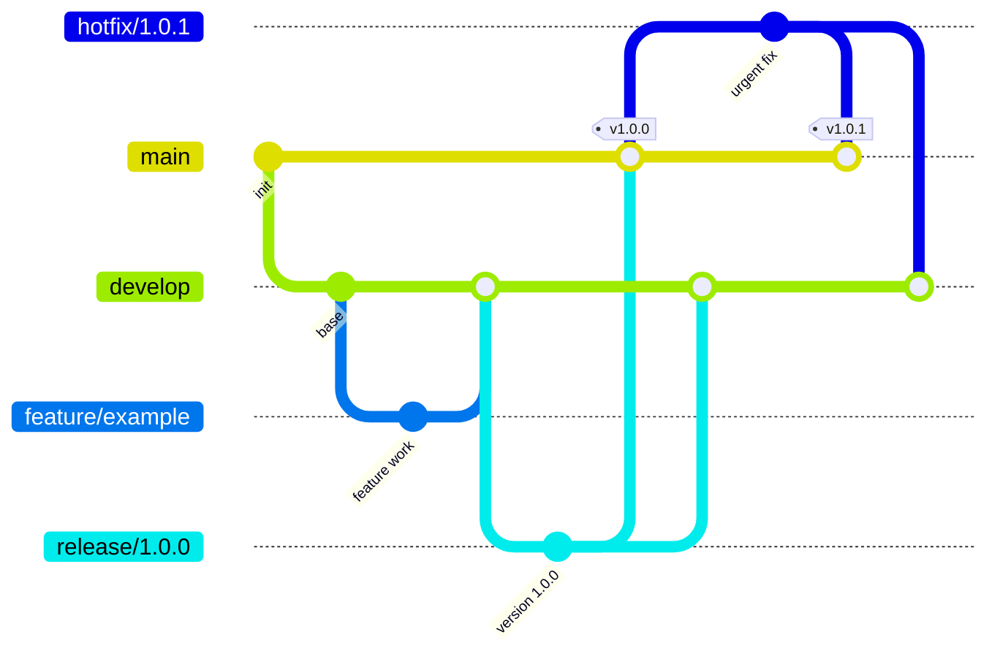
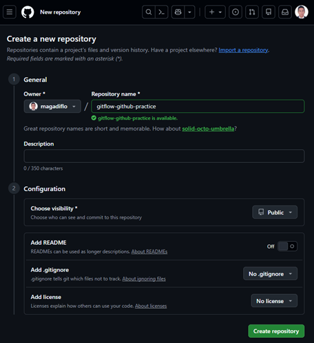
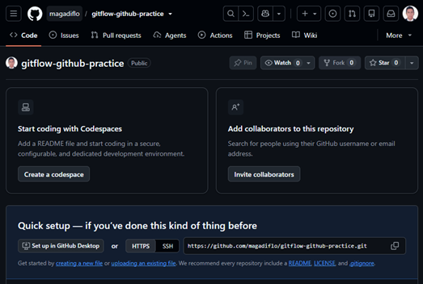
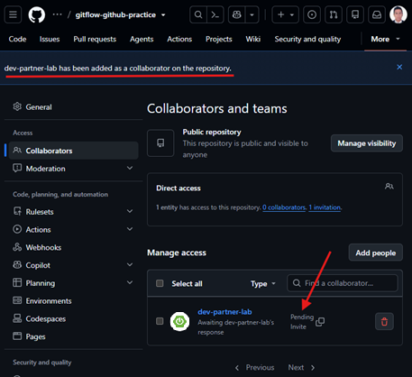
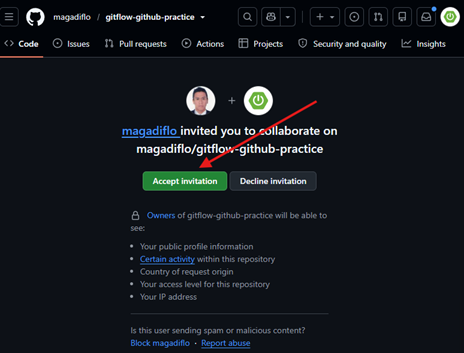
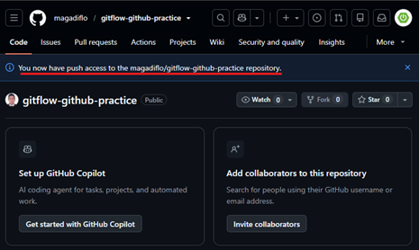

# 🌿 GitFlow con GitHub: práctica guiada con Spring Boot

Guía de consulta para aprender y recordar **GitFlow** trabajando como en un equipo: dos developers, ramas protegidas,
Pull Requests, revisiones, conflictos, releases y hotfixes.

**Fuentes de referencia:**

- [A successful Git branching model, de Vincent Driessen](https://nvie.com/posts/a-successful-git-branching-model/)
  (autor del modelo)
- [GitFlow en GitHub, de G. Mizael Mtz Hdzn (YouTube)](https://www.youtube.com/watch?v=LkYWop93S70&t=2176s)
- [GitHub Docs: reglas disponibles en los rulesets](https://docs.github.com/en/enterprise-cloud@latest/repositories/configuring-branches-and-merges-in-your-repository/managing-rulesets/available-rules-for-rulesets)
- [GitHub Docs: aprobación de Pull Requests](https://docs.github.com/en/pull-requests/how-tos/review-pull-requests/approving-a-pull-request-with-required-reviews)
- [Git Credential Manager: varios usuarios](https://github.com/git-ecosystem/git-credential-manager/blob/release/docs/multiple-users.md)

---

## 🧭 Índice

**Teoría**

1. [¿Qué es GitFlow?](#que-es)
2. [Ramas, origen y destino](#ramas)
3. [Convenciones del equipo](#convenciones)
4. [Versionado y tags](#versionado)

**Práctica**

5. [Equipo, reglas y recorrido](#equipo)
6. [Preparación del entorno](#preparacion)
7. [Escenario 1: primera feature](#e1)
8. [Escenario 2: Pull Request rechazado](#e2)
9. [Escenario 3: conflicto entre dos features](#e3)
10. [Escenario 4: release 1.0.0 con un bugfix](#e4)
11. [Escenario 5: hotfix 1.0.1](#e5)
12. [Escenario 6: hotfix 1.0.2 con una release abierta](#e6)
13. [Escenario 7: publicación de la release 1.1.0](#e7)

**Consulta**

14. [Recetas rápidas](#recetas)
15. [Índice de comandos](#comandos)
16. [Errores comunes y buenas prácticas](#buenas-practicas)

### ⚡ Necesito...

| Necesito...                             | Receta                          | Ejemplo completo               |
|-----------------------------------------|---------------------------------|--------------------------------|
| Crear una funcionalidad                 | [Feature](#receta-feature)      | [Escenario 1](#e1)             |
| Corregir un PR rechazado                | [PR rechazado](#receta-rechazo) | [Escenario 2](#e2)             |
| Resolver un conflicto                   | [Conflicto](#receta-conflicto)  | [Escenario 3](#e3)             |
| Publicar una versión                    | [Release](#receta-release)      | [Escenarios 4](#e4) y [7](#e7) |
| Corregir un error de producción         | [Hotfix](#receta-hotfix)        | [Escenario 5](#e5)             |
| Hacer un hotfix con una release abierta | [Hotfix](#receta-hotfix)        | [Escenario 6](#e6)             |

---

## 📚 ¿Qué es GitFlow?

**GitFlow** es un modelo de ramificación: un conjunto de reglas que define **qué ramas existen, de dónde nace cada una,
dónde se integra y cuándo se elimina**. No es un comando ni una función de Git. Técnicamente, todas son ramas normales;
lo que cambia es cómo las usa el equipo.

Usa dos **ramas principales** (permanentes) y varias **ramas de soporte** (temporales).

### 🧠 ¿Cuándo conviene usarlo?

El propio autor agregó en 2020
una [nota de reflexión](https://nvie.com/posts/a-successful-git-branching-model/#note-of-reflection-march-5-2020):

- ✅ GitFlow puede encajar bien si el software tiene **versiones explícitas** o si hay que **dar soporte a varias
  versiones** en uso.
- ⚠️ Si el equipo hace **entrega continua** (habitual en aplicaciones web), recomienda un flujo más simple, como
  **GitHub Flow**.

No es una receta universal: cada equipo elige según su contexto.

> ℹ️ El modelo básico mantiene una sola línea en producción. Dar soporte simultáneo a varias versiones (por ejemplo,
> `1.x` y `2.x`) requiere ramas de mantenimiento adicionales, que esta práctica no cubre.

### 🗺️ El gráfico del autor


*Gráfico de [Vincent Driessen](https://nvie.com/about/),
tomado de [su artículo](https://nvie.com/posts/a-successful-git-branching-model/).
Licencia [CC BY-SA](https://creativecommons.org/licenses/by-sa/4.0/).*

El tiempo avanza de **arriba hacia abajo**. El gráfico es de 2010, así que usa otros nombres:

| En el gráfico                    | En esta guía            |
|----------------------------------|-------------------------|
| `master`                         | `main`                  |
| `release-*`                      | `release/<version>`     |
| `hotfix-*`                       | `hotfix/<version>`      |
| Nombres libres para las features | `feature/<descripcion>` |
| Tags como `1.0`                  | `v1.0.0`                |

### 🔭 El flujo resumido



> ℹ️ Los gráficos usan **Mermaid**. GitHub los dibuja automáticamente. Si tu editor muestra solo el código, necesitas
> un visor o extensión con soporte para Mermaid. Los gráficos están **simplificados**: no dibujan las ramas auxiliares
> usadas para resolver conflictos.

---

## 🌳 Ramas, origen y destino

### 🏛️ Ramas principales

Tienen vida indefinida. **Nunca se eliminan** y en esta práctica **nadie hace push directo** a ellas después de la
preparación inicial.

- **`main`**: refleja lo que está **en producción o listo para producción**. Cada integración a `main` representa una
  versión nueva y recibe un tag.
- **`develop`**: es la rama de integración. Contiene los últimos cambios terminados para la **próxima versión**.

### 🧩 Ramas de soporte

Tienen vida limitada y se eliminan al cumplir su propósito.

- **`feature/*`**: desarrolla una funcionalidad.
- **`release/*`**: prepara una versión. Se prueba y solo admite correcciones y ajustes de la versión. **No entran
  funcionalidades nuevas.**
- **`hotfix/*`**: corrige un error urgente de producción. Como nace de `main`, no arrastra los cambios de `develop` que
  aún no se han publicado.

### 🔀 Tabla de origen y destino

| Rama                               | Sale de               | Se integra a             | ¿Se elimina?         |
|------------------------------------|-----------------------|--------------------------|----------------------|
| `main`                             | — (rama inicial)      | —                        | No                   |
| `develop`                          | `main` (una sola vez) | —                        | No                   |
| `feature/*`                        | `develop`             | `develop`                | Sí                   |
| `release/*`                        | `develop`             | `main` **y** `develop`   | Sí, después de ambas |
| `hotfix/*`                         | `main`                | `main` **y** `develop`   | Sí, después de ambas |
| `hotfix/*` con una release abierta | `main`                | `main` **y** `release/*` | Sí, después de ambas |

> 📌 `develop` **no se integra directamente a `main`**. Sus cambios llegan mediante una `release/*`.

> 📌 Una **release abierta** es una rama `release/*` ya creada que todavía no ha terminado (por ejemplo, aún está
> siendo probada). Si en ese momento se necesita un hotfix, este se integra en `main` y en la **release abierta**. La
> corrección llega a `develop` cuando la release se integra en `develop`. Si `develop` la necesita antes, el hotfix
> también se integra directamente en `develop`.

Para entender mejor el caso de un `hotfix/*` **con una release abierta**, veamos el siguiente ejemplo:

1. En producción (`main`) está la versión `1.0.1`.
2. Creas `release/1.1.0` desde `develop` y empiezan las pruebas. **La release está abierta.**
3. Mientras pruebas la release, aparece un error urgente en producción.
4. Creas `hotfix/1.0.2` desde `main` y corriges el error.
5. El hotfix se integra en:
    - `main`, para corregir producción (y se crea el tag `v1.0.2`).
    - `release/1.1.0`, para que la próxima versión también tenga la corrección.
6. Cuando `release/1.1.0` supera las pruebas, se integra en `main` y en `develop`. Así, la corrección del hotfix llega
   también a `develop`.

Si no integras el hotfix en la **release abierta**, esta no tendrá la corrección: probarías la `1.1.0` sin el arreglo y
la corrección no llegaría a `develop` a través de la release.

**¿Y si `develop` necesita la corrección antes?**

Por ejemplo, un developer está trabajando en una feature y ese error no le permite avanzar. En ese caso, no espera a que
termine la release: el hotfix se integra en `main`, en la `release` abierta y además en `develop`. La rama del hotfix se
elimina después de completar esas integraciones.

### 🛠️ Ramas adicionales (convenciones de equipo)

No son tipos del modelo original, pero ayudan cuando todo entra mediante **Pull Requests:**

| Rama       | Sale de     | Se integra a         | Para qué                                                        |
|------------|-------------|----------------------|-----------------------------------------------------------------|
| `bugfix/*` | `release/*` | La misma `release/*` | Error encontrado al probar la release                           |
| `bugfix/*` | `develop`   | `develop`            | Error aún no publicado, fuera de una release                    |
| `chore/*`  | `develop`   | `develop`            | Cambiar la versión o resolver conflictos al traer otros cambios |
| `chore/*`  | `release/*` | La misma `release/*` | Resolver conflictos al llevar un hotfix a la release            |

> ℹ️ El [artículo original de Vincent Driessen](https://nvie.com/posts/a-successful-git-branching-model/), autor de
> GitFlow, permite corregir errores **directamente** en la `release/*`. Aquí usamos `bugfix/*` para que cada corrección
> pase por un Pull Request y tenga su revisión.

> ℹ️ Una rama `chore/*` es temporal y sirve para tareas de apoyo, no para crear funcionalidades ni corregir errores.
> Por ejemplo, para llevar `release/1.0.0` a `develop` cuando hay conflictos: se crea la `chore/*` desde `develop`, se
> hace merge de `release/1.0.0` dentro de ella, se resuelven los conflictos y se abre un PR hacia `develop`. Se elimina
> después de integrarse.
>
> En general, `chore` se usa para tareas de mantenimiento. En esta guía nos limitamos a esos dos usos para que sea fácil
> de seguir.

---

## 📏 Convenciones del equipo

### 🏷️ Nombres de ramas

En inglés, en minúsculas y con guiones.

| Tipo          | Formato                       | Ejemplo                               |
|---------------|-------------------------------|---------------------------------------|
| Feature       | `feature/<descripcion>`       | `feature/create-product`              |
| Release       | `release/<MAJOR.MINOR.PATCH>` | `release/1.0.0`                       |
| Hotfix        | `hotfix/<MAJOR.MINOR.PATCH>`  | `hotfix/1.0.1`                        |
| Bugfix        | `bugfix/<descripcion>`        | `bugfix/case-insensitive-name-search` |
| Mantenimiento | `chore/<descripcion>`         | `chore/back-merge-release-1.0.0`      |

> 💼 En muchas empresas se agrega el código del ticket: `feature/PROJ-123-create-product`.

### ✍️ Mensajes de commit

Usamos [Conventional Commits](https://www.conventionalcommits.org/), con el formato
`tipo(alcance opcional): descripción`.

| Tipo       | Uso                                          | Ejemplo                                |
|------------|----------------------------------------------|----------------------------------------|
| `feat`     | Funcionalidad nueva                          | `feat: add endpoint to list products`  |
| `fix`      | Corrección de un error                       | `fix: validate product name and price` |
| `chore`    | Mantenimiento                                | `chore(release): set version 1.0.0`    |
| `test`     | Solo pruebas                                 | `test: add product service tests`      |
| `docs`     | Solo documentación                           | `docs: update README`                  |
| `refactor` | Mejora interna sin cambiar el comportamiento | `refactor: simplify product filters`   |

### 🔁 Estrategia de integración

En todos los PR usamos `Create a merge commit`. Equivale a un merge con `--no-ff`: siempre crea un commit de merge,
así que el historial muestra qué commits entraron juntos.

> 💼 **En otras empresas:** muchas usan **Squash and merge** (un commit por feature) o **Rebase and merge** (historial
> lineal). Depende del equipo. En GitFlow conviene el commit de merge, sobre todo en `release/*` y `hotfix/*`: como van
> a dos destinos, un squash crearía commits distintos en cada uno y Git no reconocería que es el mismo trabajo.

---

## 🔢 Versionado y tags

Usamos [versionado semántico](https://semver.org/lang/es/): **`MAJOR.MINOR.PATCH`**.

| Parte     | Sube cuando...                                                        | Ejemplo           |
|-----------|-----------------------------------------------------------------------|-------------------|
| **MAJOR** | Hay cambios **incompatibles**: los clientes de la API deben adaptarse | `1.4.2` → `2.0.0` |
| **MINOR** | Se agrega funcionalidad **compatible**                                | `1.0.2` → `1.1.0` |
| **PATCH** | Se **corrige** un error de forma compatible                           | `1.0.0` → `1.0.1` |

- Cuando sube un número, **los de su derecha vuelven a cero**.
- El número lo decide **el tipo de cambio publicado**, no el nombre de la rama. Una release que solo trae correcciones
  sería PATCH; una con funcionalidades compatibles, MINOR.
- Ejemplo de `2.0.0`: renombrar en el JSON el campo `price` a `unitPrice`. Los clientes que leen `price` dejarían de
  funcionar. El flujo sería el de una release (`release/2.0.0`).

### 📅 Línea de versiones de esta práctica

| Orden | Rama            | Tag      | Motivo                                       |
|-------|-----------------|----------|----------------------------------------------|
| 1     | `release/1.0.0` | `v1.0.0` | Primera versión estable                      |
| 2     | `hotfix/1.0.1`  | `v1.0.1` | Corrección en producción                     |
| 3     | `hotfix/1.0.2`  | `v1.0.2` | Otra corrección, con `release/1.1.0` abierta |
| 4     | `release/1.1.0` | `v1.1.0` | Funcionalidad nueva compatible               |

### ☕ Versión en Maven

| Valor en `pom.xml` | Significado                               |
|--------------------|-------------------------------------------|
| `1.1.0-SNAPSHOT`   | Versión **en desarrollo** (puede cambiar) |
| `1.1.0`            | Versión **final** de una release          |

El **tag** lleva el prefijo `v` (`v1.1.0`); la versión de Maven no (`1.1.0`). Usamos **tags anotados** (`git tag -a`),
que guardan autor, fecha y mensaje.

---

## 👥 Equipo, reglas y recorrido

| Usuario           | Correo                         | Rol                                              | Directorio de trabajo         |
|-------------------|--------------------------------|--------------------------------------------------|-------------------------------|
| `magadiflo`       | magadiflo@gmail.com            | Líder técnico y developer. Dueño del repositorio | `M:\practice\magadiflo`       |
| `dev-partner-lab` | martin.g.diaz.flores@gmail.com | Developer                                        | `M:\practice\dev-partner-lab` |

### ✅ Reglas de revisión

- Todo cambio en `main` y `develop` entra mediante un **Pull Request** (PR).
- **El autor de un PR no puede aprobarlo** en GitHub. Aprueba el otro usuario.
    - PR de `dev-partner-lab` → revisa `magadiflo`.
    - PR de `magadiflo` → revisa `dev-partner-lab`.
- Después de la aprobación, **en esta práctica `magadiflo` hace el merge**. Aprobar y hacer merge son acciones
  distintas.
- No usamos permisos de administrador para saltarnos las reglas.

### 🏷️ Cómo leer esta guía

Antes de cada grupo de pasos verás quién los ejecuta:

- 👑 **`[magadiflo]`**: trabaja en `M:\practice\magadiflo\gitflow-github-practice`.
- 🧑‍💻 **`[dev-partner-lab]`**: trabaja en `M:\practice\dev-partner-lab\gitflow-github-practice`.

> 💡 El usuario `magadiflo` **usará la línea de comando Cmder**, mientras que el usuario `dev-partner-lab` usará el
> **Git Bash**. Para GitHub en la web, **un navegador o perfil distinto por cuenta** (o una ventana privada).
> Así no confundes quién hace cada acción.

> 📦 Cada comando se explica **la primera vez** que aparece. Si luego aparece con una opción nueva, se explica solo esa
> opción. Consulta el [índice de comandos](#comandos).

### 🛣️ Recorrido de la práctica

| PR  | Escenario | Rama origen → destino                                           | Autor           | Aprueba         |
|-----|-----------|-----------------------------------------------------------------|-----------------|-----------------|
| #1  | 1         | `feature/list-products` → `develop`                             | dev-partner-lab | magadiflo       |
| #2  | 2         | `feature/create-product` → `develop`                            | dev-partner-lab | magadiflo       |
| #3  | 3         | `feature/search-products-by-name` → `develop`                   | magadiflo       | dev-partner-lab |
| #4  | 3         | `feature/filter-products-by-max-price` → `develop`              | dev-partner-lab | magadiflo       |
| #5  | 4         | `chore/bump-version-1.1.0-snapshot` → `develop`                 | magadiflo       | dev-partner-lab |
| #6  | 4         | `bugfix/case-insensitive-name-search` → `release/1.0.0`         | dev-partner-lab | magadiflo       |
| #7  | 4         | `release/1.0.0` → `main`                                        | magadiflo       | dev-partner-lab |
| #8  | 4         | `chore/back-merge-release-1.0.0` → `develop`                    | magadiflo       | dev-partner-lab |
| #9  | 5         | `hotfix/1.0.1` → `main`                                         | magadiflo       | dev-partner-lab |
| #10 | 5         | `chore/back-merge-hotfix-1.0.1` → `develop`                     | magadiflo       | dev-partner-lab |
| #11 | 6         | `feature/get-product-by-id` → `develop`                         | dev-partner-lab | magadiflo       |
| #12 | 6         | `chore/bump-version-1.2.0-snapshot` → `develop`                 | magadiflo       | dev-partner-lab |
| #13 | 6         | `hotfix/1.0.2` → `main`                                         | dev-partner-lab | magadiflo       |
| #14 | 6         | `chore/merge-hotfix-1.0.2-into-release-1.1.0` → `release/1.1.0` | dev-partner-lab | magadiflo       |
| #15 | 7         | `release/1.1.0` → `main`                                        | magadiflo       | dev-partner-lab |
| #16 | 7         | `chore/back-merge-release-1.1.0` → `develop`                    | magadiflo       | dev-partner-lab |

> ℹ️ Los números de PR de la tabla (`#1`, `#2`, ...) son referenciales. GitHub los asigna automáticamente con un mismo
> contador para Issues y Pull Requests. Si antes creas un Issue o un PR adicional (aunque luego lo cierres), tus números
> serán distintos. En ese caso, guíate por las ramas de origen y destino.

---

## 🧰 Preparación del entorno

**Necesitas:** Git para Windows (incluye Git Credential Manager), JDK 25, un editor o IDE y las dos cuentas de GitHub.
No necesitas instalar Maven: el proyecto trae **Maven Wrapper**.

### 1️⃣ Verificar herramientas

👑 **`[magadiflo]`**

```bash
$ git --version
$ java -version
$ git credential-manager --version
```

**¿Qué hacen?** Confirman que las herramientas están instaladas.

- `git --version`: muestra la versión de Git.
- `java -version`: muestra la versión de Java que se ejecuta. Debe ser la 25.
- `git credential-manager --version`: muestra la versión de **Git Credential Manager (GCM)**, el programa que guarda y
  entrega tus credenciales de GitHub cuando usas HTTPS.

`git switch` requiere Git 2.23 o superior.

### 2️⃣ Revisar la configuración global y los alias

👑 **`[magadiflo]`**

```bash
C:\cmder
$ git config --global --list
core.editor="C:\Users\magadiflo\AppData\Local\Programs\Microsoft VS Code\bin\code" --wait
filter.lfs.clean=git-lfs clean -- %f
filter.lfs.smudge=git-lfs smudge -- %f
filter.lfs.process=git-lfs filter-process
filter.lfs.required=true
user.name=Martín Díaz
user.email=magadiflo@gmail.com
alias.lg=log --oneline --decorate --all --graph
alias.s=status -s -b
credential.https://github.com.username=magadiflo
```

**¿Qué hace?** Muestra la configuración que aplica a **todos los repositorios** de tu usuario de Windows.

- `git config`: lee o escribe la configuración de Git.
- `--global`: trabaja con la configuración global (archivo `.gitconfig` de tu usuario).
- `--list`: lista las claves y sus valores.

`magadiflo` **usará esta identidad global**; no hay que cambiar nada.

#### 🔤 Alias de la práctica

**En nuestra PC ya existen.** Estos comandos quedan como referencia para otra computadora:

```bat
git config --global alias.lg "log --oneline --decorate --all --graph"
git config --global alias.s "status -s -b"
```

**¿Qué hacen?** Crean atajos: `git lg` y `git s`. Un **alias** es un nombre corto para un comando; no viene con Git por
defecto.

- `alias.lg "..."`: al escribir `git lg`, Git ejecuta `git log` con estas opciones:
    - `log`: muestra el historial de commits.
    - `--oneline`: un commit por línea, con el hash abreviado y el mensaje.
    - `--decorate`: muestra qué ramas y tags apuntan a cada commit.
    - `--all`: incluye el historial de todas las referencias (ramas locales, remotas y tags), no solo la rama actual.
    - `--graph`: dibuja las bifurcaciones y merges con líneas.
- `alias.s "..."`: al escribir `git s`, Git ejecuta `git status` con estas opciones:
    - `status`: muestra el estado de los archivos.
    - `-s`: formato corto (*short*). Por ejemplo, `??` es un archivo sin seguimiento, `M` modificado, `A` agregado y
      `UU` en conflicto.
    - `-b`: incluye la rama actual y su relación con la rama remota.

> 💡 Los alias son globales y ambos directorios usan la misma cuenta de Windows, así que sirven para los dos usuarios. Si
> `git lg` abre un visor paginado, sal con la tecla `q`.

### 3️⃣ Crear el repositorio en GitHub

👑 **`[magadiflo]`** (en el navegador)

1. **New repository**.
2. **Repository name:** `gitflow-github-practice`.
3. **Visibility:** **Public**. Con GitHub Free, los rulesets están disponibles en repositorios públicos.
4. **No agregues** README, `.gitignore` ni licencia. El repositorio debe quedar **vacío**.
5. **Create repository**.

> ⚠️ Como es público, nunca subas contraseñas, tokens ni datos privados. Los correos de los commits también quedan
> visibles. Si quieres ocultar el tuyo, GitHub ofrece una dirección `noreply` en **Settings → Emails**.





### 4️⃣ Invitar al colaborador

👑 **`[magadiflo]`** (en el navegador)

1. En el repositorio: **Settings → Collaborators → Add people**.
2. Busca `dev-partner-lab` y envía la invitación.



🧑‍💻 **`[dev-partner-lab]`** (en su navegador)

1. Abre la invitación (desde el correo o las notificaciones de GitHub).
2. **Accept invitation**.



Con esto obtiene permiso de escritura: puede subir ramas y sus aprobaciones cuentan para las reglas.



### 5️⃣ Clonar el repositorio (magadiflo)

👑 **`[magadiflo]`**

````bash
C:\cmder
$ mkdir M:\practice\magadiflo\

C:\cmder
$ cd /d M:\practice\magadiflo\

M:\practice\magadiflo
$ git clone https://github.com/magadiflo/gitflow-github-practice.git
Cloning into 'gitflow-github-practice'...
warning: You appear to have cloned an empty repository.

M:\practice\magadiflo
$ cd gitflow-github-practice\

M:\practice\magadiflo\gitflow-github-practice (main -> origin)
$ 
````

**¿Qué hacen?** Crean el área de trabajo de `magadiflo`, descargan el repositorio y entran en él.

- `mkdir M:\practice\magadiflo`: crea la carpeta (en Cmder/CMD también crea las carpetas intermedias que falten). La
  unidad `M:` debe existir.
- `cd /d M:\practice\magadiflo`: cambia de carpeta. `/d` permite cambiar también de **unidad** (por ejemplo, de `C:` a
  `M:`).
- `git clone <url>`: copia el repositorio remoto a tu PC, con su historial, y registra el remoto con el nombre
  **`origin`**.
    - `https://`: protocolo usado para comunicarse con GitHub.
    - `github.com/magadiflo/gitflow-github-practice.git`: servidor, **dueño** del repositorio y nombre del repositorio.
- `cd gitflow-github-practice`: entra en la carpeta recién creada.

La advertencia es esperada: el repositorio está vacío.

#### 🪪 Comprobar la identidad

Primero revisamos la configuración **local** del repositorio, para verificar que no tenga una identidad propia:

````bash
M:\practice\magadiflo\gitflow-github-practice (main -> origin)
$ git config --local --list
core.repositoryformatversion=0
core.filemode=false
core.bare=false
core.logallrefupdates=true
core.symlinks=false
core.ignorecase=true
remote.origin.url=https://github.com/magadiflo/gitflow-github-practice.git
remote.origin.fetch=+refs/heads/*:refs/remotes/origin/*
branch.main.remote=origin
branch.main.merge=refs/heads/main
````

- `--local`: trabaja únicamente con la configuración de **este repositorio**, guardada en `.git/config`.
- `--list`: lista las claves y sus valores.

En el resultado no aparecen `user.name`, `user.email` ni `credential.https://github.com.username`.

Ahora revisamos la configuración **global**:

````bash
M:\practice\magadiflo\gitflow-github-practice (main -> origin)
$ git config --global --list
core.editor="C:\Users\magadiflo\AppData\Local\Programs\Microsoft VS Code\bin\code" --wait
filter.lfs.clean=git-lfs clean -- %f
filter.lfs.smudge=git-lfs smudge -- %f
filter.lfs.process=git-lfs filter-process
filter.lfs.required=true
user.name=Martín Díaz
user.email=magadiflo@gmail.com
alias.lg=log --oneline --decorate --all --graph
alias.s=status -s -b
credential.https://github.com.username=magadiflo
````

Como el repositorio no define una identidad local, Git usará la global para la **autoría de los commits**:

- `user.name`: nombre que figurará como autor.
- `user.email`: correo del autor. GitHub lo usa para asociar el commit con una cuenta.

Además, en la configuración global tenemos esta entrada:

````bash
credential.https://github.com.username=magadiflo 
````

La establecimos anteriormente, en otro proyecto, con el siguiente comando. Por eso ya aparece aquí y **no es necesario
volver a ejecutarlo**:

````bash
C:\cmder
$ git config --global credential.https://github.com.username "magadiflo"
````

- `credential.https://github.com.username`: indica el nombre de usuario para las credenciales de `https://github.com`.
- `"magadiflo"`: nombre de la cuenta de GitHub que se usará **por defecto** para autenticarse. Si un repositorio no
  indica otra cuenta, ya sea en su configuración local o en la URL remota, **Git Credential Manager (GCM)** usará la
  credencial de `magadiflo`, por ejemplo al hacer `git push`. Si todavía no la tiene guardada, pedirá iniciar sesión.

Al ser una configuración global, se aplica a los repositorios que usen `https://github.com` con nuestro usuario de
Windows. Tienen prioridad sobre ella una configuración local del repositorio o un usuario escrito en la URL remota.

> ℹ️ Esta entrada **no guarda una contraseña ni un token**, y tampoco define el autor de los commits. Solo indica qué
> cuenta usar al autenticarse.

Más adelante, como trabajaremos con otro usuario, en el repositorio de `dev-partner-lab` configuraremos **a nivel
local** tanto su identidad como su cuenta de GitHub.

En resumen:

| Configuración                            | Responde a                                  |
|------------------------------------------|---------------------------------------------|
| `user.name` y `user.email`               | ¿Quién figura como **autor del commit**?    |
| `credential.https://github.com.username` | ¿Con qué **cuenta de GitHub** me autentico? |

### 6️⃣ Crear el proyecto Spring Boot

👑 **`[magadiflo]`**
(en [start.spring.io](https://start.spring.io/#!type=maven-project&language=java&platformVersion=4.2.0&packaging=jar&configurationFileFormat=yaml&jvmVersion=25&groupId=dev.magadiflo&artifactId=gitflow-github-practice&packageName=dev.magadiflo.gitflow.app&dependencies=web,lombok))

| Campo        | Valor                                      |
|--------------|--------------------------------------------|
| Project      | Maven                                      |
| Language     | Java                                       |
| Spring Boot  | 4.2.0 (o el último parche estable `4.2.x`) |
| Group        | `dev.magadiflo`                            |
| Artifact     | `gitflow-github-practice`                  |
| Name         | `gitflow-github-practice`                  |
| Package name | `dev.magadiflo.gitflow.app`                |
| Packaging    | Jar                                        |
| Java         | 25                                         |
| Dependencies | **Spring Web**, **Lombok**                 |

1. Presiona **Generate** y descarga el ZIP.
2. Extrae **el contenido** de la carpeta del ZIP dentro de `M:\practice\magadiflo\gitflow-github-practice`. El `pom.xml`
   debe quedar en la raíz del repositorio, junto a la carpeta oculta `.git`. Incluye también `.gitignore`,
   `.gitattributes` y `.mvn`.
3. En `pom.xml`, cambia **la versión del proyecto** (la que está debajo de
   `<artifactId>gitflow-github-practice</artifactId>`, **no** la de `<parent>`):
    ```xml
    <version>1.0.0-SNAPSHOT</version>
    ```

> ℹ️ Deja que Initializr genere el `pom.xml`. Incluye el starter web (`spring-boot-starter-webmvc` en Spring Boot 4),
> su starter de pruebas (`spring-boot-starter-webmvc-test`, que trae JUnit y AssertJ), Lombok y la configuración para
> que Lombok procese sus anotaciones. No reemplaces ese archivo.

Comprueba que el proyecto funciona antes del primer commit:

```bash
M:\practice\magadiflo\gitflow-github-practice (main -> origin)
$ mvnw clean test
...
[INFO] Tests run: 1, Failures: 0, Errors: 0, Skipped: 0, Time elapsed: 2.301 s -- in dev.magadiflo.gitflow.app.GitflowGithubPracticeApplicationTests
[INFO]
[INFO] Results:
[INFO]
[INFO] Tests run: 1, Failures: 0, Errors: 0, Skipped: 0
[INFO]
[INFO] ------------------------------------------------------------------------
[INFO] BUILD SUCCESS
[INFO] ------------------------------------------------------------------------
[INFO] Total time:  9.501 s
[INFO] Finished at: 2026-11-27T17:59:19-05:00
[INFO] ------------------------------------------------------------------------
```

**¿Qué hace?** Compila el proyecto desde cero y ejecuta las pruebas.

- `mvnw`: ejecuta **Maven Wrapper** (en Windows, el archivo `mvnw.cmd`). Usa la versión de Maven definida por el
  proyecto y la descarga si todavía no está disponible.
- `clean`: borra la carpeta `target`, donde quedan los archivos de compilaciones anteriores.
- `test`: compila el proyecto y ejecuta sus pruebas.

Al generar el proyecto con Spring Initializr, también se genera esta prueba por defecto:

````java
@SpringBootTest
class GitflowGithubPracticeApplicationTests {

    @Test
    void contextLoads() {
    }

}
````

- `@SpringBootTest`: carga el contexto de la aplicación Spring Boot para la prueba.
- `contextLoads()`: aunque está vacío, la prueba **falla si el contexto de Spring no puede cargarse**, por ejemplo por
  un error de configuración. Si pasa, sabemos que el contexto se cargó correctamente.

> ℹ️ Con la configuración por defecto de `@SpringBootTest`, esta prueba no levanta un servidor web real. La aplicación
> la ejecutaremos más adelante con `mvnw spring-boot:run`.

### 7️⃣ Primer commit y creación de `develop`

👑 **`[magadiflo]`**

````bash
M:\practice\magadiflo\gitflow-github-practice (main -> origin)
$ git s
## No commits yet on main...origin/main [gone]
?? .gitattributes
?? .gitignore
?? .mvn/
?? mvnw
?? mvnw.cmd
?? pom.xml
?? src/

M:\practice\magadiflo\gitflow-github-practice (main -> origin)
$ git add .
warning: in the working copy of '.gitattributes', LF will be replaced by CRLF the next time Git touches it
warning: in the working copy of '.gitignore', LF will be replaced by CRLF the next time Git touches it
warning: in the working copy of '.mvn/wrapper/maven-wrapper.properties', LF will be replaced by CRLF the next time Git touches it
warning: in the working copy of 'mvnw.cmd', LF will be replaced by CRLF the next time Git touches it
warning: in the working copy of 'pom.xml', LF will be replaced by CRLF the next time Git touches it
warning: in the working copy of 'src/main/java/dev/magadiflo/gitflow/app/GitflowGithubPracticeApplication.java', LF will be replaced by CRLF the next time Git touches it
warning: in the working copy of 'src/main/resources/application.yml', LF will be replaced by CRLF the next time Git touches it
warning: in the working copy of 'src/test/java/dev/magadiflo/gitflow/app/GitflowGithubPracticeApplicationTests.java', LF will be replaced by CRLF the next time Git touches it

M:\practice\magadiflo\gitflow-github-practice (main -> origin)
$ git commit -m "chore: initialize Spring Boot project"
[main (root-commit) 7733657] chore: initialize Spring Boot project
 9 files changed, 631 insertions(+)
 create mode 100644 .gitattributes
 create mode 100644 .gitignore
 create mode 100644 .mvn/wrapper/maven-wrapper.properties
 create mode 100644 mvnw
 create mode 100644 mvnw.cmd
 create mode 100644 pom.xml
 create mode 100644 src/main/java/dev/magadiflo/gitflow/app/GitflowGithubPracticeApplication.java create mode 100644 src/main/resources/application.yml
 create mode 100644 src/test/java/dev/magadiflo/gitflow/app/GitflowGithubPracticeApplicationTests.java

M:\practice\magadiflo\gitflow-github-practice (main -> origin)
$ git push -u origin main
Enumerating objects: 27, done.
Counting objects: 100% (27/27), done.
Delta compression using up to 8 threads
Compressing objects: 100% (15/15), done.
Writing objects: 100% (27/27), 9.51 KiB | 1.58 MiB/s, done.
Total 27 (delta 0), reused 0 (delta 0), pack-reused 0 (from 0)
To https://github.com/magadiflo/gitflow-github-practice.git
 * [new branch]      main -> main
branch 'main' set up to track 'origin/main'. 
````

> ℹ️ Estamos en la rama `main`, como muestra la consola. Si tu rama inicial tuviera otro nombre, por ejemplo `master`,
> antes de hacer el push renómbrala con `git branch -M main`. Aquí `branch -M` cambia el nombre de la rama actual;
> la opción `-M` fuerza el cambio, incluso si ya existiera una rama local con el nombre de destino, así que úsala con
> cuidado.

**¿Qué hacen?** Revisan los archivos, guardan el proyecto en un commit y lo suben a GitHub.

- `git s`: nuestro alias de estado. Úsalo **antes de agregar** para saber qué cambios hay en el proyecto y dónde se
  encuentran: en el **working directory** (aún sin preparar) o en el **staging area** (listos para el commit). También
  muestra los archivos nuevos que Git todavía no rastrea. Aprovecha para revisar que no vayas a agregar archivos que no
  quieres subir.
- `git add .`: agrega al **área de preparación** (*staging*) los cambios de la carpeta actual y sus subcarpetas. `.`
  significa "la carpeta actual". Respeta las reglas de `.gitignore` para los archivos que aún no están rastreados.
- `git commit -m "..."`: crea un commit con lo preparado.
    - `-m`: define el mensaje en el mismo comando.
    - `chore:`: es el **tipo** de commit, según la convención que seguimos. **Indica una tarea de mantenimiento o
      configuración.** En este caso, subir la base del proyecto, que todavía no incluye funcionalidades de nuestra API
      ni corrige errores.
    - `initialize Spring Boot project`: es la **descripción** del commit, un resumen breve del cambio (*"inicializa el
      proyecto Spring Boot"*). Por convención, el verbo se escribe en **modo imperativo**: `initialize`, no
      `initialized` ni `initializes`.
- `git push -u origin main`: envía los commits al repositorio remoto.
    - `origin`: nombre del remoto.
    - `main`: rama que se sube.
    - `-u` (`--set-upstream`): vincula la rama local con `origin/main`. Después podrás usar `git push` sin más datos.

> 🔐 En el primer `push`, GCM puede abrir el navegador. **Inicia sesión como `magadiflo`**. Si ya tiene guardada esa
> credencial, no preguntará.
