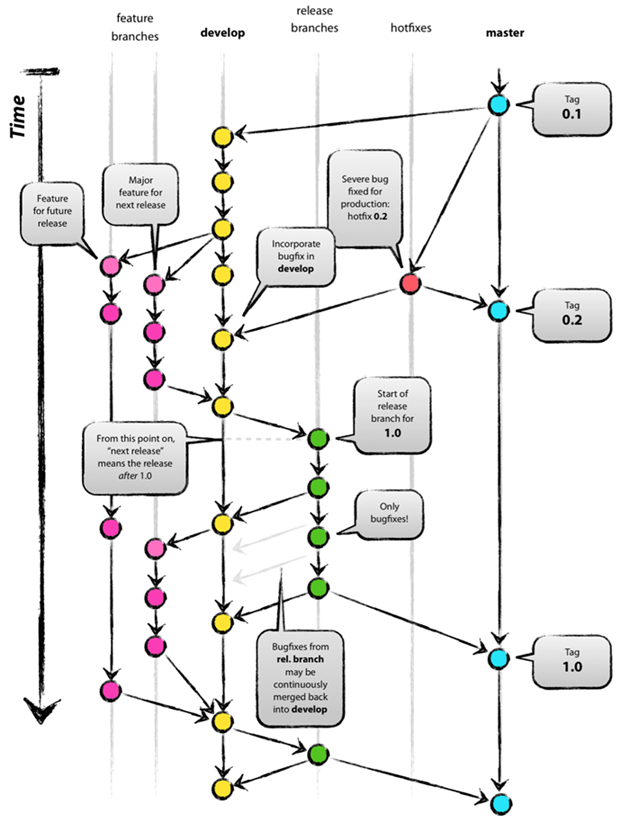
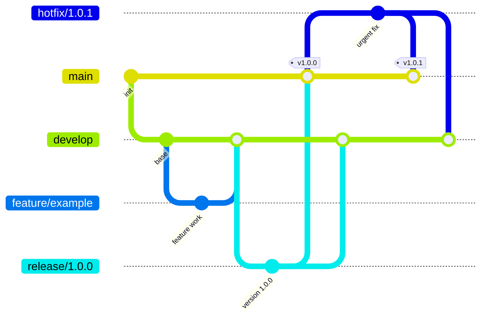

# 🌿 GitFlow con GitHub: práctica guiada con Spring Boot

Guía de consulta para aprender y recordar **GitFlow** trabajando como en un equipo: dos developers, ramas protegidas,
Pull Requests, revisiones, conflictos, releases y hotfixes.

**Fuentes de referencia:**

- [A successful Git branching model, de Vincent Driessen](https://nvie.com/posts/a-successful-git-branching-model/)
  (autor del modelo)
- [GitFlow en GitHub, de G. Mizael Mtz Hdzn (YouTube)](https://www.youtube.com/watch?v=LkYWop93S70&t=2176s)
- [GitHub Docs: reglas disponibles en los rulesets](https://docs.github.com/en/enterprise-cloud@latest/repositories/configuring-branches-and-merges-in-your-repository/managing-rulesets/available-rules-for-rulesets)
- [GitHub Docs: aprobación de Pull Requests](https://docs.github.com/en/pull-requests/how-tos/review-pull-requests/approving-a-pull-request-with-required-reviews)
- [Git Credential Manager: varios usuarios](https://github.com/git-ecosystem/git-credential-manager/blob/release/docs/multiple-users.md)

---

## 🧭 Índice

**Teoría**

1. [¿Qué es GitFlow?](#que-es)
2. [Ramas, origen y destino](#ramas)
3. [Convenciones del equipo](#convenciones)
4. [Versionado y tags](#versionado)

**Práctica**

5. [Equipo, reglas y recorrido](#equipo)
6. [Preparación del entorno](#preparacion)
7. [Escenario 1: primera feature](#e1)
8. [Escenario 2: Pull Request rechazado](#e2)
9. [Escenario 3: conflicto entre dos features](#e3)
10. [Escenario 4: release 1.0.0 con un bugfix](#e4)
11. [Escenario 5: hotfix 1.0.1](#e5)
12. [Escenario 6: hotfix 1.0.2 con una release abierta](#e6)
13. [Escenario 7: publicación de la release 1.1.0](#e7)

**Consulta**

14. [Recetas rápidas](#recetas)
15. [Índice de comandos](#comandos)
16. [Errores comunes y buenas prácticas](#buenas-practicas)

### ⚡ Necesito...

| Necesito...                             | Receta                          | Ejemplo completo               |
|-----------------------------------------|---------------------------------|--------------------------------|
| Crear una funcionalidad                 | [Feature](#receta-feature)      | [Escenario 1](#e1)             |
| Corregir un PR rechazado                | [PR rechazado](#receta-rechazo) | [Escenario 2](#e2)             |
| Resolver un conflicto                   | [Conflicto](#receta-conflicto)  | [Escenario 3](#e3)             |
| Publicar una versión                    | [Release](#receta-release)      | [Escenarios 4](#e4) y [7](#e7) |
| Corregir un error de producción         | [Hotfix](#receta-hotfix)        | [Escenario 5](#e5)             |
| Hacer un hotfix con una release abierta | [Hotfix](#receta-hotfix)        | [Escenario 6](#e6)             |

---

## 📚 ¿Qué es GitFlow?

**GitFlow** es un modelo de ramificación: un conjunto de reglas que define **qué ramas existen, de dónde nace cada una,
dónde se integra y cuándo se elimina**. No es un comando ni una función de Git. Técnicamente, todas son ramas normales;
lo que cambia es cómo las usa el equipo.

Usa dos **ramas principales** (permanentes) y varias **ramas de soporte** (temporales).

### 🧠 ¿Cuándo conviene usarlo?

El propio autor agregó en 2020
una [nota de reflexión](https://nvie.com/posts/a-successful-git-branching-model/#note-of-reflection-march-5-2020):

- ✅ GitFlow puede encajar bien si el software tiene **versiones explícitas** o si hay que **dar soporte a varias
  versiones** en uso.
- ⚠️ Si el equipo hace **entrega continua** (habitual en aplicaciones web), recomienda un flujo más simple, como
  **GitHub Flow**.

No es una receta universal: cada equipo elige según su contexto.

> ℹ️ El modelo básico mantiene una sola línea en producción. Dar soporte simultáneo a varias versiones (por ejemplo,
> `1.x` y `2.x`) requiere ramas de mantenimiento adicionales, que esta práctica no cubre.

### 🗺️ El gráfico del autor

*Gráfico de [Vincent Driessen](https://nvie.com/about/),
tomado de [su artículo](https://nvie.com/posts/a-successful-git-branching-model/).
Licencia [CC BY-SA](https://creativecommons.org/licenses/by-sa/4.0/).*

El tiempo avanza de **arriba hacia abajo**. El gráfico es de 2010, así que usa otros nombres:

| En el gráfico                    | En esta guía            |
|----------------------------------|-------------------------|
| `master`                         | `main`                  |
| `release-*`                      | `release/<version>`     |
| `hotfix-*`                       | `hotfix/<version>`      |
| Nombres libres para las features | `feature/<descripcion>` |
| Tags como `1.0`                  | `v1.0.0`                |

### 🔭 El flujo resumido

> ℹ️ Los gráficos usan **Mermaid**. GitHub los dibuja automáticamente. Si tu editor muestra solo el código, necesitas
> un visor o extensión con soporte para Mermaid. Los gráficos están **simplificados**: no dibujan las ramas auxiliares
> usadas para resolver conflictos.

---
